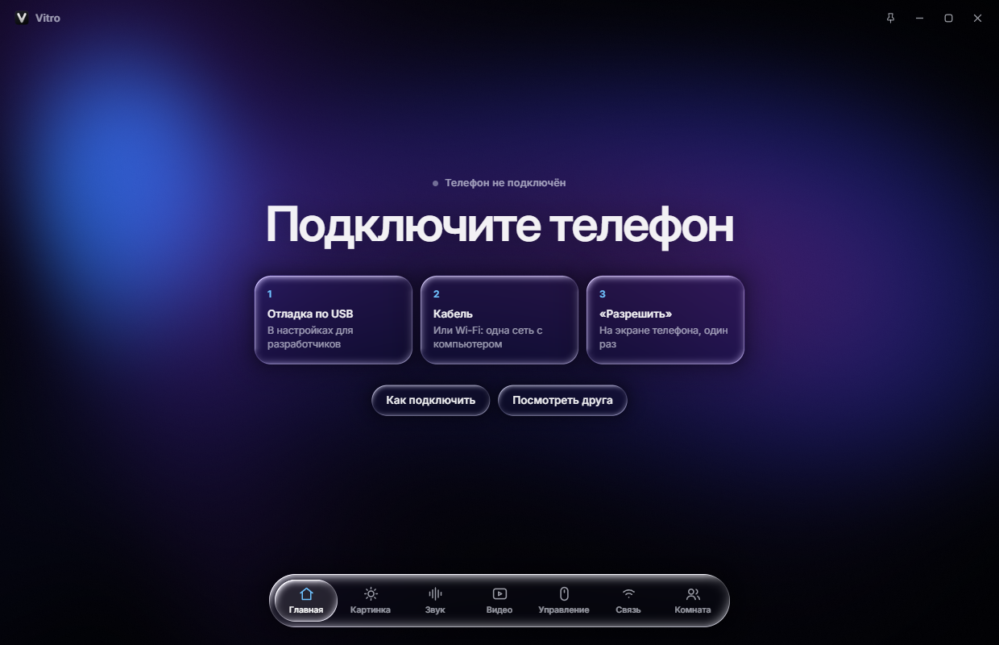

<p align="center">
  
</p>

<h1 align="center">Vitro</h1>

<p align="center">
  Экран Android-телефона на мониторе. Без задержки, с чистым звуком и в родном разрешении.<br/>
  А ещё прямо в окне у друга, без пережатия Discord.
</p>

<p align="center">
  <a href="../../releases/latest"><b>Скачать Vitro-Setup.exe</b></a> ·
  <a href="https://gigatron48.github.io/vitro/">Страница проекта</a>
</p>

<p align="center">
  
</p>

## Что это

Vitro выросло из связки `scrcpy` + батник. Батник заменило приложение с одной кнопкой, а весь путь картинки и звука на компьютере переписан с нуля. На телефоне работает официальный `scrcpy-server 5.0.1`, поэтому ничего устанавливать туда не нужно.

| Было | Стало |
|---|---|
| Запуск батником | Приложение с кнопкой «Транслировать» |
| `--fullscreen`, но с чёрными рамками | Подсветка вместо рамок, режим «Без рамок», режим «Под монитор» |
| 20 Мбит/с, H.264 | Авто до 120 Мбит/с, H.265/AV1, родное разрешение |
| Сжатый звук (Opus) | Несжатый PCM, Hi-Fi без единой обработки |
| Нет звука на Android 16 | Исправлено, плюс автопереключение способа захвата |
| Демонстрация в Discord | Комната: поток идёт другу напрямую |

## Возможности

### Картинка
- **Частота как на телефоне**: кадры не ограничиваются, сколько выдаёт экран телефона, столько и приходит.
- **Плавность ×2**: дорисовывает кадры между кадрами телефона по карте движения, чтобы телефон на 120 Гц заполнял монитор на 240 Гц. Добавляет один кадр задержки.
- **Без мыла**: своё масштабирование Lanczos с расширением ядра при уменьшении и адаптивная резкость.
- **Живые настройки во время трансляции**: яркость, контраст, тени, света, насыщенность, сочность, теплота, резкость, объём.
- **HDR**: на HDR-мониторе блики идут выше белого. На обычном мониторе пресет расширяет тон и локальный контраст.
- **Без рамок**: находит чёрные поля внутри самого видео и убирает их. «Под монитор» создаёт на телефоне отдельный рабочий стол в разрешении монитора.

### Звук
- Несжатый PCM 48 кГц с телефона. Пресет **Hi-Fi** не трогает ни одного сэмпла.
- Пресеты: Бас, Чистый звук, Кино, Игры, Ночь, и свой десятиполосный эквалайзер со спектром поверх.
- **Объёмный звук 5.1 и 7.1** для наушников: стерео раскладывается на виртуальные колонки и переводится в бинауральный звук по модели головы (задержка между ушами, тень головы, отражения комнаты).
- Лимитер не даёт клиппинга, плавная подстройка убирает щелчки и рассинхрон часов телефона и ПК.

### Комнаты
Друг показывает телефон или экран, ты смотришь в своём Vitro.

- Вход по 9-значному коду или приглашением из списка друзей Steam.
- Видео идёт напрямую, без пережатия: другу уходит то, что закодировал телефон. Для медленного канала на телефоне запускается второй кодировщик под его скорость, а картинка у хозяина не страдает.
- Сеть из LowLag: пробивка NAT, реле Steam, автоматический переход на прямой канал, шифрование ChaCha20-Poly1305.
- Обычное окно: Alt+Tab, сворачивание, игра параллельно, звук продолжает идти. Кнопка-булавка держит окно поверх остальных.
- **Управление по кнопке**: хозяин даёт его конкретному зрителю тумблером и забирает в любой момент, нажатые кнопки сразу отпускаются. **Ctrl+Alt+X** из любой программы мгновенно обрывает показ.
- Зрителю недоступны буфер обмена, запуск приложений и питание экрана.

### Управление с компьютера
Левая кнопка мыши как палец, правая «Назад», средняя «Домой», колесо крутит, Ctrl+тянуть щипок. Клавиатура работает как настоящая физическая, с русской раскладкой. Ctrl+V вставляет текст с компьютера, копирование на телефоне попадает в буфер ПК.

### Подключение
- **Кабель**: включите «Отладку по USB» и нажмите «Разрешить» на телефоне.
- **Wi-Fi**: одна кнопка, если телефон уже подключён кабелем, QR-код для Android 11+ или код сопряжения. Адрес запоминается.
- На Xiaomi, POCO и Redmi дополнительно нужна «Отладка по USB (настройки безопасности)».

## Почему у друга пропал звук

В scrcpy 3.2 захват звука сломан на Android 16, это исправили в 3.3 ([релиз](https://github.com/Genymobile/scrcpy/releases/tag/v3.3)). Vitro работает на версии 5.0.1, а если на конкретном телефоне стандартный способ не даёт звука, само переключается на захват приложений.

## Как это устроено

```
Телефон                     Компьютер                                Друг
scrcpy-server 5.0.1         Vitro                                    Vitro
 ├ экран → H.265 ─────────► Rust → Web Worker → WebCodecs → WebGPU
 │                             (аппаратный декодер, Lanczos, HDR, стекло)
 ├ второй H.265 ──────────► комната ───── зашифрованный UDP / Steam ───► тот же плеер
 ├ звук PCM ──────────────► DSP → WASAPI
 └ управление ◄──────────── мышь, клавиатура ◄──── только с разрешения ── зритель
```

- **Liquid Glass** нарисован шейдером, а не CSS: форма задана полем расстояний, кромка преломляет то, что под ней, с лёгкой дисперсией, а блик следует за курсором. Поэтому стекло честно искажает живое видео.
- **Интерфейс и видео** в одном окне WebView2 через WebGPU, поэтому панели настроек парят над картинкой.
- **Задержка декодера** на тестовом потоке 1080×2400 при 120 к/с: менее 1 мс.

## Лицензии

Vitro: проприетарная программа, код закрыт, условия в [LICENSE](LICENSE). Внутри используются scrcpy (Apache 2.0), adb, FFmpeg, SDL, Opus, шрифт Inter и Steamworks. Их лицензии перечислены в `THIRD_PARTY_NOTICES.txt` рядом с установленной программой.
